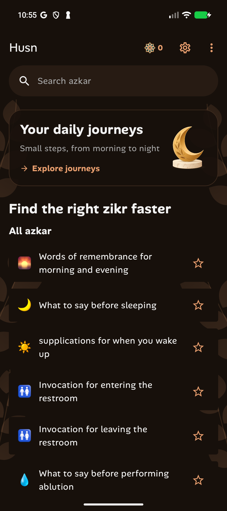

# Search focus after Back navigation

Material Adaptive automatically requests focus on the destination pane when it
changes. On compact layouts, returning to the list focused its first input,
search. PaneScaffoldDirective now explicitly sets
`shouldAutoFocusCurrentDestination = false`. Pane sizing, spacing, and excluded
hinge bounds are preserved. There is no timed navigation focus reset.

The window-startup focus fallback is retained for Android 8 compatibility.
Native input still focuses when tapped, and the saved query survives returning
from a reading screen.

The regression reproduced the failure before the change on both compact phones.
It now checks toolbar Back from Settings and system Back from a reading screen
after typing a query, then confirms tapping can focus search again.
All 52 device checks passed, 13 each on Android 8/API 26 and the API 37 phone,
tablet, and Fold. This includes the existing startup/recreation focus test.

A live phone check also returned from Settings using system Back without
opening the keyboard.

