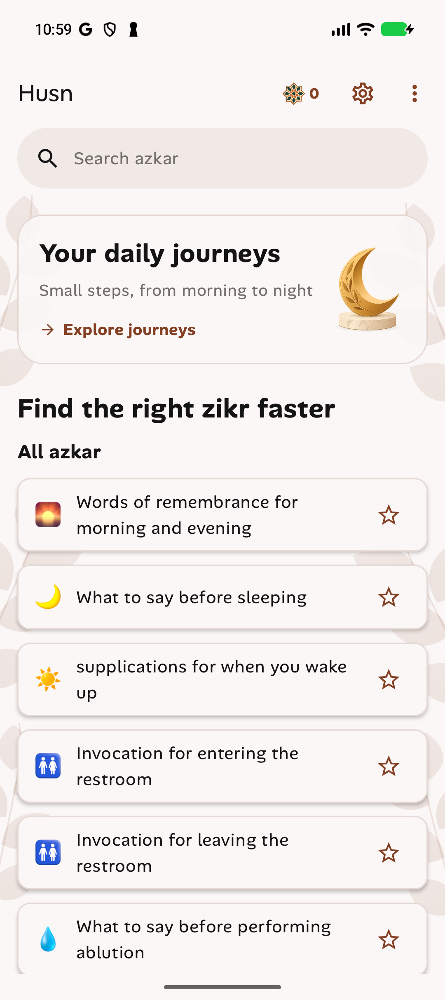
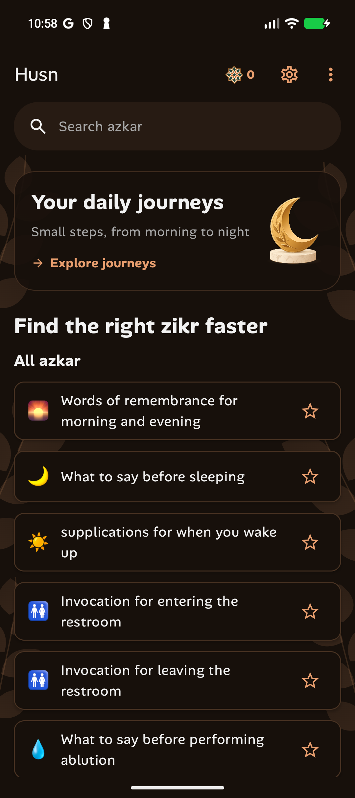

# Item card styling

Category items use the shared native OutlinedCard container. Item cards have a
1dp accent border, 16% opacity in light mode and 24% in dark mode, with 2dp
Material shadow elevation. Existing card shapes, native list interactions,
favorites, and content are preserved.

Debug build passed. Light and dark screenshots were inspected on the phone.

