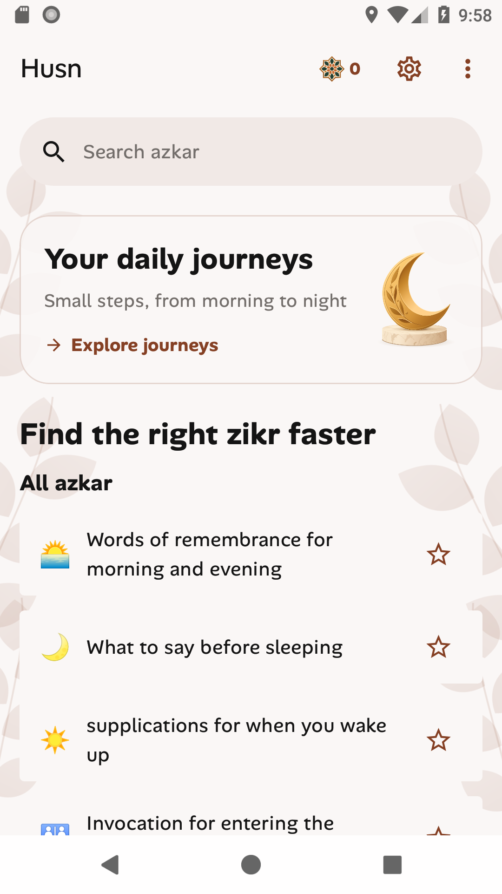
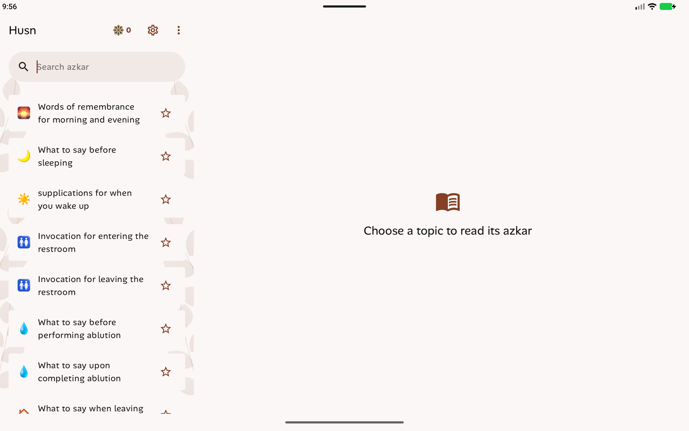

# Material 3 Expressive verification

The Android UI uses the actual Material 3 Expressive library, pinned to
1.5.0-alpha29 with Compose alpha BOM 2026.09.00. Expressive is currently prerelease;
the dependency is explicit in the version catalog and upgrades need regression checks.

MaterialExpressiveTheme supplies motion, shapes, colors, and emphasized typography.
Interactive list items, cards, buttons with pressed shapes, loading indicators,
the wavy counter indicator, and time-picker dialogs use Material components.
TopAppBar, SearchBar, DropdownMenu, switches, and sheets inherit the theme.
Alan Sans, devotional assets, and selectable brand accents are preserved.

## Compatibility

- Minimum: Android 8.0/API 26. Target: API 37.
- Compile: API 37.2, required by the aligned Compose library metadata. This does
  not change the minimum Android version.
- Verified devices: API 26 Pixel emulator and API 37 phone, Pixel Tablet, Pixel Fold.
- Adaptive list/detail panes remain available on tablet and unfolded layouts.
- Time dialogs support clock and text input; short windows automatically use
  text input. Cancel discards drafts; Save persists the time across recreation.
- Per-app language uses platform locale APIs on API 33+ and a resource fallback
  on older Android. Runtime tests cover English/Arabic and dark mode.

## Limits

Tests run in emulators. Physical-device frame timing, Play purchases, and
notification delivery after reboot still need separate checks. City-catalog
backend authentication is pending. No purchase was made during verification.

## Results

44 device checks passed (11 on each of the four emulators), including reminder
time editing and cancellation, favorites, search, counter, Arabic/dark settings,
adaptive panes, activity recreation, concurrent cache reads, lossless DataStore
migration, and inexact alarms. The XML reports are saved beside this file.
11 unit tests passed. Debug/release APK packaging and Android lint passed; lint
reported zero errors and zero NewApi findings. All 267 shared asset checksums
match the canonical iOS source.

## Screenshots

