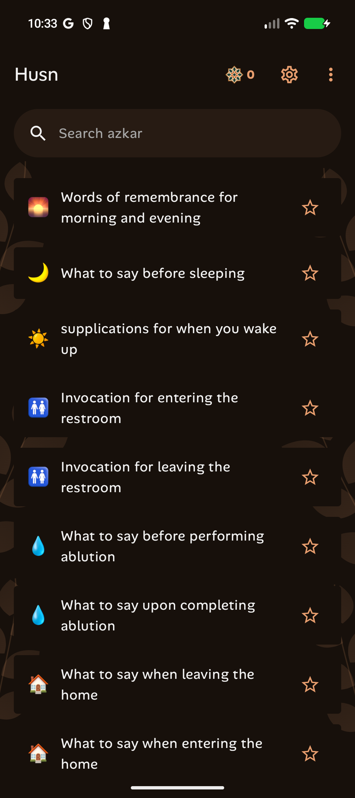
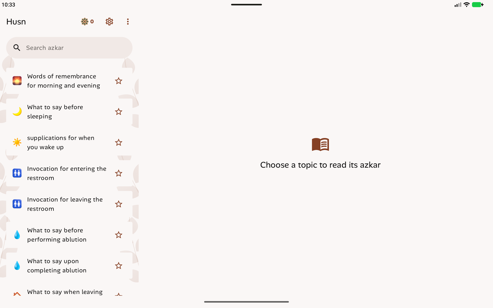

# Search focus regression

Android selected the list search input when home content appeared and when the
activity window restored focus. The screen now receives initial focus after
content loading and window focus restoration. Search keeps its native Material
input and accepts focus when tapped. Submit clears focus and hides the keyboard.

The new behavioral check covers startup, activity recreation, tapping, typing,
and submitting. All 48 device checks passed, 12 each on Android 8/API 26 and the
API 37 phone, tablet, and Fold. XML reports are saved here.

Phone and tablet screenshots were captured after skipping onboarding and the
location prompt, without tapping search or dismissing a keyboard.

